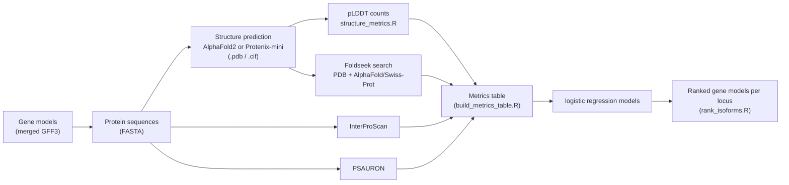

# GeneStructor

[](LICENSE)
[](https://www.r-project.org/)
[](https://doi.org/10.5281/zenodo.23880730)

**Rank the gene models at a locus by the protein structures they encode.**

GeneStructor scores every gene model (transcript) at a gene locus using the predicted structure of the protein it
encodes, how well the folded structure matches known protein structures, and sequence-based evidence. An ensemble of logistic
regression models, trained on manually curated rice gene models, combines this evidence into one score per gene model,
and the gene models at each locus are ranked by that score.

It was developed to resolve conflicting gene models in the rice (*Oryza sativa*) Nipponbare reference genome, where the
RAP-DB, RGAP (MSU) and Gramene annotations frequently disagree, and is designed to be adaptable to other species with
competing gene models or alternative isoforms.

**Contact:** Eshan Sharma and Andrew R. Jones ([PGB-LIV](https://github.com/PGB-LIV)). Please report problems on the
[issue tracker](https://github.com/PGB-LIV/GeneStructor/issues).

## Contents

- [How GeneStructor works](#how-genestructor-works)
- [Benchmark on rice](#benchmark-on-rice)
- [Installation](#installation)
- [Quick start: from .pdb files to ranked gene models](#quick-start-from-pdb-files-to-ranked-gene-models)
- [Running on your own gene models](#running-on-your-own-gene-models)
- [Output](#output)
- [Interpreting the results](#interpreting-the-results)
- [Repository layout](#repository-layout)
- [Data availability](#data-availability)
- [Citation and license](#citation-and-license)

## How GeneStructor works



1. **Collect the gene models.** Gene models from one or more annotations are merged so that every transcript belongs
   to a parent gene locus, and the encoded protein sequences are extracted.
2. **Compute the evidence.** Each protein is folded with AlphaFold2 (ColabFold) or Protenix-mini. Each structure is
   searched against PDB and the AlphaFold/Swiss-Prot database with Foldseek, and each sequence is scanned with
   InterProScan and PSAURON.
3. **Score.** Four metrics, one per tool, are passed to 25 trained logistic regression models. The median predicted
   probability of being a curated gene model is the GeneStructor score.
4. **Rank.** Gene models are ranked within each gene by their score. The score difference between the top two models
   shows how clearly the best model stands out.

### Evidence used

| Tool | Metric (column name) | What it captures |
|---|---|---|
| [AlphaFold2](https://github.com/sokrypton/ColabFold) | `plddt_80`: number of residues with pLDDT > 80 | Size of the confidently predicted, ordered region |
| [Foldseek](https://github.com/steineggerlab/foldseek) | `bits.max`: maximum bitscore of the top hit against PDB or AlphaFold/Swiss-Prot | Structural conservation with known proteins |
| [InterProScan](https://github.com/ebi-pf-team/interproscan) | `total_domain_length`: total length of InterPro or Pfam domains (whichever is larger), overlapping domains merged | Domain completeness |
| [PSAURON](https://github.com/salzberg-lab/PSAURON) | `in_frame_score`: in-frame score (0–1) | Integrity of the coding sequence |

## Benchmark on rice

### AlphaFold2 or Protenix-mini

| | AlphaFold2 (ColabFold) | Protenix-mini |
|---|---|---|
| Structure prediction | MSA-based; more accurate, slower | Protein language model, no MSA; much faster, slightly less accurate |
| pLDDT metric | residues with pLDDT > 80 | residues with pLDDT > 70, used in place of pLDDT > 80 |
| Used in rice for | training and evaluation on core rice genes |  All rice gene loci in merged annotations |
| `rank_isoforms.R` option | `--source alphafold` | `--source protenix` |

The same 25 models are used for both. On the core rice genes, the two implementations ranked the same gene model first
in 94.7 % of genes.


## Installation

GeneStructor is a set of R scripts (with optional Python helpers); there is nothing to compile.

**R (≥ 4.4)** with:

```r
install.packages(c("data.table", "dplyr", "tidymodels", "glmnet", "bio3d"))
# optional, for plotting gene models
install.packages(c("ggplot2", "cowplot", "tidyr", "stringr"))
```

**External tools**, only needed to compute metrics for new proteins (versions used in the manuscript):

| Tool | Version | Purpose |
|---|---|---|
| [ColabFold](https://github.com/sokrypton/ColabFold) (AlphaFold2) | 1.5.2 | Structure prediction |
| [Protenix](https://github.com/bytedance/Protenix) (Protenix-mini) | 0.5.0 (esm) | Faster structure prediction |
| [Foldseek](https://github.com/steineggerlab/foldseek) | 9-427df8a | Structure search |
| [InterProScan](https://github.com/ebi-pf-team/interproscan) | 5 | Domain annotation |
| [PSAURON](https://github.com/salzberg-lab/PSAURON) |  1.0.8 | In-frame score |

The trained models can be obtained from [Zenodo](https://doi.org/10.5281/zenodo.23880730).

## Quick start: from .pdb files to ranked gene models

The [`example/`](example/) folder holds the inputs for one rice gene, Os06g0113150, with two competing gene
models: the RAP-DB model Os06t0113150-00 and the Gramene model OsNip_06G000900_01. It contains their AlphaFold2
structures (`structures/*.pdb`), the Foldseek, InterProScan and PSAURON results for the same proteins, and the gene
models' coordinates (`Os06g0113150.gff3`) for plotting.

```bash
git clone https://github.com/PGB-LIV/GeneStructor.git
cd GeneStructor

# 1. pLDDT counts from the structures
Rscript scripts/structure_metrics.R --input-dir example/structures --out structure_metrics.csv

# 2. combine all evidence into one table
Rscript scripts/build_metrics_table.R \
  --ids example/transcript_gene.tab \
  --structure-map example/structure_map.tsv \
  --structures structure_metrics.csv \
  --foldseek-pdb example/foldseek_pdb.m8 \
  --foldseek-afsp example/foldseek_afsp.m8 \
  --interpro example/interproscan.tsv \
  --psauron example/psauron_scores.csv \
  --out metrics.tsv

# 3. score and rank the gene models
Rscript scripts/rank_isoforms.R --metrics metrics.tsv --source alphafold --out ranked.tsv

# 4. plot the ranked gene models of the gene
Rscript scripts/plot_ranked_gene.R \
  --ranked ranked.tsv \
  --gff example/Os06g0113150.gff3 \
  --gene Os06g0113150 \
  --out Os06g0113150.png
```

Step 4 needs the R packages `ggplot2`, `cowplot`, `tidyr` and `stringr`. It draws the CDS (and UTR, if present) features
from the GFF3, colours each gene model by its source annotation and labels it with its rank and GeneStructor score. For
your own genes, pass your merged GFF3 and any gene ID from the `Gene` column of `ranked.tsv`.

The results should match [`example/expected_metrics.tsv`](example/expected_metrics.tsv) and
[`example/expected_ranked.tsv`](example/expected_ranked.tsv). The Gramene gene model OsNip_06G000900_01 is ranked first (score 1.00), well ahead of the RAP-DB gene model Os06t0113150-00 (0.64).
The longer protein it encodes folds with 1,374 confidently predicted residues and aligns almost completely to the
structure of *Arabidopsis* callose synthase 10:


## Running on your own gene models

### 1. Transcript-to-gene table and protein sequences

GeneStructor ranks gene models that share a parent gene, so it needs a tab-separated table linking each transcript to
its gene (columns `ID` and `Parent`). With several annotations, merge them first so that overlapping gene models share a
parent gene. For rice, RAP-DB genes were used as the reference, and Gramene and then RGAP gene models were assigned to a
RAP-DB gene when they overlapped it on the same strand; otherwise they formed new genes. The merged rice annotation is
on [Zenodo](https://doi.org/10.5281/zenodo.23880730). [`scripts/Simplified_GFF.rmd`](scripts/Simplified_GFF.rmd)
extracts the table from a GFF3, and protein sequences can be extracted with, for example,
[gffread](https://github.com/gpertea/gffread):

```bash
gffread merged.gff3 -g genome.fa -y proteins.fa
```

Gene models that encode the same protein need only one structure. If you fold each distinct protein once, list which
structure each transcript uses in a two-column table (`transcript_id`, `structure_id`) and pass it with
`--structure-map`, as in the example.

### 2. Structures and pLDDT counts

Predict one structure per protein with ColabFold or Protenix-mini, and name each file after the transcript (or
structure) ID:

```bash
colabfold_batch --msa-mode mmseqs2_uniref_env \
  --num-models 3 \
  --data <path/to/colabfold_databases> \
  --use-gpu-relax \
  --amber \
  proteins.fa structures/

Rscript scripts/structure_metrics.R --input-dir structures/ --out structure_metrics.csv --cores 8
```

`structure_metrics.R` reads `.pdb` and `.cif` files. When building the metrics table, the ColabFold and Protenix file
suffixes (`_unrelaxed_rank_001_…`, `_sample_0`) are removed and only the top-ranked ColabFold model is used. The
Python parser [`scripts/process_colabfold_all.py`](scripts/process_colabfold_all.py) also reads ColabFold JSON files
and reports pTM.

### 3. Foldseek

```bash
foldseek databases PDB pdb tmp
foldseek databases Alphafold/Swiss-Prot afsp tmp

FMT="query,target,alntmscore,lddt,fident,alnlen,mismatch,gapopen,qstart,qend,tstart,tend,evalue,bits,taxid,taxname,taxlineage"
foldseek easy-search structures/ pdb  foldseek_pdb.m8  tmp --exhaustive-search -e 0.00001 --format-output "$FMT"
foldseek easy-search structures/ afsp foldseek_afsp.m8 tmp --exhaustive-search -e 0.00001 --format-output "$FMT"
```

For each structure, the hit with the lowest E-value is used. If your species is itself in AlphaFold/Swiss-Prot, remove
self-hits with `--exclude-taxon` in step 5 (for rice: `--exclude-taxon "Oryza sativa Japonica Group"`).

### 4. InterProScan and PSAURON

```bash
interproscan.sh -i proteins.fa -f TSV -o interproscan.tsv -cpu 8

psauron -i proteins.fa -o psauron_scores.csv -p
```


### 5. Metrics table and ranking

```bash
Rscript scripts/build_metrics_table.R \
  --ids transcript_gene.tab \
  --structures structure_metrics.csv \
  --foldseek-pdb foldseek_pdb.m8 --foldseek-afsp foldseek_afsp.m8 \
  --interpro interproscan.tsv \
  --psauron psauron_scores.csv \
  --out metrics.tsv

Rscript scripts/rank_isoforms.R --metrics metrics.tsv --source alphafold --out ranked.tsv
# for Protenix-mini structures use --source protenix (pLDDT > 70 is used in place of pLDDT > 80)
```


## Output

`ranked.tsv` has one row per distinct gene model:

| Column | Description |
|---|---|
| `Gene` | Parent gene |
| `ML_rank` | Rank within the gene (1 = best); gene models whose scores round to the same value share a rank |
| `transcript_id` | Representative gene model |
| `transcript_id_collapsed` | All gene models of the gene with identical metrics (usually identical proteins) |
| `median_pred_CT` | GeneStructor score: median probability of the curated class across the 25 models |
| `prob_diff_to_rank_1` | Score difference to the rank 1 gene model of the gene |
| `sd_pred_CT`, `n_models` | Spread of the 25 predictions and the number of models used |
| `plddt_80` or `plddt_70`, `bits.max`, `total_domain_length`, `in_frame_score` | The metrics used |


## Interpreting the results

- **Score difference.** A difference > 0.1 between rank 1 and rank 2 indicates considerable structural differences
  between the gene models and a strongly preferred model; these loci are the highest priority for curation. Smaller
  differences usually reflect small differences in protein structure.
- **Very long gene models.** GeneStructor is not designed to distinguish one long gene from two falsely merged genes,
  especially when both parts fold into well-defined domains. 
- **Inspect the alignment.** For loci of interest, align the top-ranked and alternative structures to their Foldseek
  hits to see which parts of the known structure each gene model covers.

## Repository layout

```
GeneStructor/
├── README.md
├── LICENSE
├── models/                              logistic regression models 
├── example/                             quick-start inputs (rice gene Os06g0113150) and expected outputs
├── scripts/
│   ├── structure_metrics.R              pLDDT counts from .pdb / .cif structures
│   ├── build_metrics_table.R            combine all evidence into one metrics table
│   ├── rank_isoforms.R                  score and rank gene models with the ensemble
│   ├── plot_ranked_gene.R               plot the ranked gene models of one gene from ranked.tsv and a GFF3
│   ├── plot_single_gene_with_labels.R   plotting functions (used by plot_ranked_gene.R)
│   ├── predict_with_glm_ensemble.r      ensemble prediction function (used by rank_isoforms.R)
│   ├── process_interproscan_results.r   total InterPro and Pfam domain length (used by build_metrics_table.R)
│   ├── Simplified_GFF.rmd               transcript-to-gene table from a merged GFF3
│   ├── process_colabfold_all.py         pLDDT and pTM from ColabFold JSON/PDB and CIF files (Python)
│   ├── process_cif_for_pLDDT.R          pLDDT counts for the Protenix-mini run on all rice loci (HPC)
│   ├── process_fs_protenix_all_nip.py   top Foldseek hits for the Protenix-mini run (per-structure .m8 files)
│   └── rename_chr_in_gff.r              rename chromosomes (1 → chr01) in a GFF
└── docs/
    └── GeneStructor_Rank_isoforms.md    walkthrough of the Protenix-mini ranking of all rice loci
```

## Data availability

The merged rice annotation, protein sequences, structure, Foldseek, InterProScan and PSAURON results, the training
data and the trained models are on Zenodo: [10.5281/zenodo.23880730](https://doi.org/10.5281/zenodo.23880730).


## Citation and license

If you use GeneStructor, please cite the manuscript above (the citation will be updated on publication) and the tools
it builds on: AlphaFold2/ColabFold, Protenix, Foldseek, InterProScan and PSAURON.

GeneStructor is released under the [Apache License 2.0](LICENSE).
